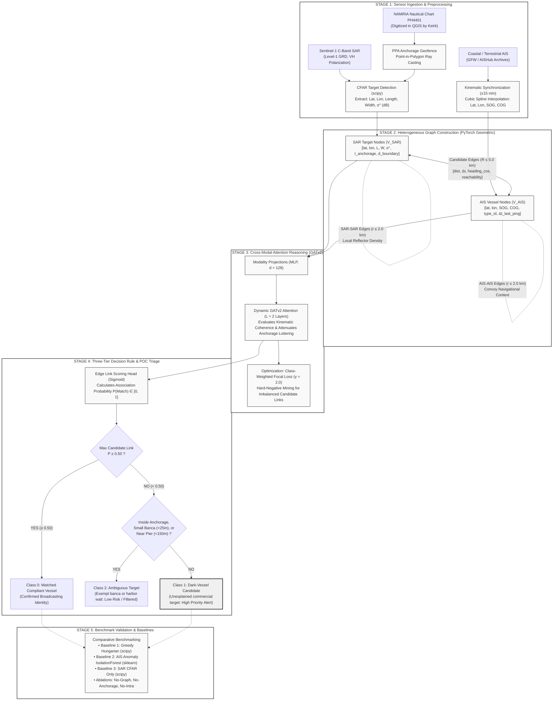

# System Architecture & Framework Flow
### Cross-Modal Spatiotemporal Graph Framework for Dark-Vessel Candidate Detection
> **Proponents:** Sandara Bajio | Keirk Xandrex Brual | Janison Giane Bustos (CS-4102)  
> **Adviser:** Dr. Princess Marie Melo  
> **Accompanying High-Resolution Vector Diagram:** [Architecture_Framework_Diagram.svg](file:///C:/Users/Drexsy/Desktop/Thesis%20workplace/Topic_Proposal/Architecture_Framework_Diagram.svg)

---

## 1. High-Level Architecture Flowchart

---

## 2. Step-by-Step Flow Explanation (How to Explain to the Panel)

### Stage 1: Data Ingestion & Preprocessing
- **SAR Satellite Branch:** Sentinel-1 radar images pass through a standard Constant False Alarm Rate (CFAR) algorithm (`scipy.signal`) to detect ships as metallic reflectors, extracting their coordinates, length, width, and radar brightness.
- **AIS GPS Branch:** Broadcasted coastal AIS records within $\pm 15\text{ minutes}$ of the satellite overpass are interpolated using cubic Hermite splines (`scipy.interpolate`) to estimate exact ship positions at the moment the satellite took the picture.
- **Harbor Geofence:** Keirk digitizes the Batangas Port anchorage boundary from the official NAMRIA map in QGIS. `GeoPandas` flags which radar detections are sitting inside this harbor boundary.

### Stage 2: Heterogeneous Graph Construction (`torch_geometric.data.HeteroData`)
- **Two Node Types:** AIS nodes (carrying speed, course, ping age) and SAR nodes (carrying size, radar brightness, anchorage flag).
- **Candidate Links ($\le 5.0\text{ km}$):** Draws unconstrained connection lines between every radar blip and any ship within 5 km (the physical drift limit at 12 knots over 15 minutes).
- **Neighbor Links ($\le 2.0\text{ km}$):** Connects neighboring AIS ships to each other, and neighboring radar blips to each other, so the model learns convoy patterns and congested harbor queues.

### Stage 3: Cross-Modal Attention (`GATv2Conv`)
- **Shared Space ($d = 128$):** Small MLPs project AIS and SAR features into a common embedding space.
- **2 Layers of GATv2:** GATv2 computes attention weights on every candidate link. It checks:
  1. *Are they close enough?*
  2. *Is the ship moving in the same direction the radar blob is pointing?*
  3. *Is the ship parked inside the anchorage area?* (If yes, stationary behavior is treated as normal waiting, not suspicious).
- **Focal Loss ($\gamma = 2.0$):** Handles class imbalance because 90% of candidate lines are false connections.

### Stage 4: Three-Tier Decision Rule and Candidate Alerting
- An edge scoring head calculates a matching probability between 0% and 100%.
- **Decision Rule ($\tau = 0.50$):**
  1. *If match probability $\ge 50\%$* $\rightarrow$ **Class 0: Matched Compliant Vessel** (normal broadcasting traffic).
  2. *If match probability $< 50\%$, check ambiguity:*
     - Is it inside the official port anchorage area?
     - Is it a small artisanal banca ($< 25\text{ m}$, legally exempt from AIS under IMO SOLAS)?
     - Is it within $150\text{ m}$ of a pier or breakwater (land clutter)?
     - **If YES** $\rightarrow$ **Class 2: Ambiguous Target** (Low Risk / Filtered out to avoid false alarms).
     - **If NO** $\rightarrow$ **Class 1: Dark-Vessel Candidate** (High Risk: unexplained commercial ship in fairway, flagged for Coast Guard patrol triage).

### Stage 5: Benchmark Validation Ladder
- Evaluated against 3 baselines:
  1. *Hungarian Matching:* Simple distance matching (proves graph beats distance).
  2. *AIS Anomaly:* Trajectory-only ML (proves radar is needed when transponders are off).
  3. *SAR CFAR:* Radar-only (proves AIS cross-referencing is needed).
- And 3 ablation models (turning off graph, anchorage filter, and neighbor edges one by one).
