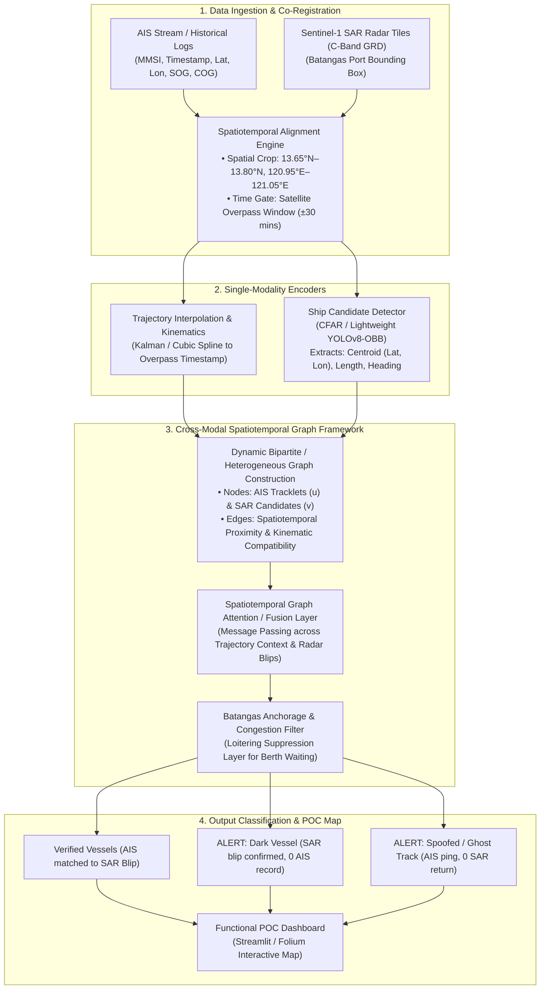
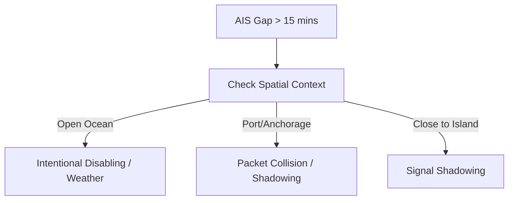

# Group 2 Thesis Master Guide: Dark-Vessel Detection via Cross-Modal AIS-SAR Graph Framework

> **Institution:** Batangas State University (BatStateU) — College of Informatics and Computing Sciences  
> **Course:** CS Thesis 1 & 2 (BS Computer Science)  
> **Group 2 Members:**  
> • 23-04923 BAJIO, SANDARA B.  
> • 23-02544 BRUAL, KEIRK XANDREX M.  
> • 23-02686 BUSTOS, JANISON GIANE A.  
> **Reference Document:** Official Consultation Feedback (`CS Thesis 2.2.pdf`)  
> **Target Geographic Region:** Batangas Port Anchorage & Verde Island Passage Approaches  
> **Budget & Compute:** ₱0 Direct Cost | Google Colab / Kaggle GPU & 100% Free Open-Access Data  

---

## 1. Executive Summary & The Dean's Verdict

During the topic consultation, the Dean reviewed Group 2's submission and formally approved **Thesis Idea 3**, ordering a mandatory strategic refinement:

| What Was Originally Proposed | The Dean's Mandated Pivot | Why This Shift Was Necessary |
| :--- | :--- | :--- |
| **"Illegal Dumping Detection"** (Claiming to detect ships releasing hazardous waste at sea). | **"Dark-Vessel or AIS-Discrepancy Detection"** using Cross-Modal Spatiotemporal Graph Alignment. | **Lack of Ground-Truth Labels:** In Computer Science, an AI cannot be trained or validated on unobservable phenomena. Unless you have onboard chemical lab tests or Coast Guard arrests for every hour of satellite imagery, you cannot prove illegal dumping. Claiming this would lead to immediate failure during defense. |
| Broad or undefined maritime boundary. | **Focused Bounding Box:** Batangas Port & Verde Island Passage Anchorage. | Prevents computational explosion and keeps data processing feasible on free GPU resources. |
| Potential reliance on a "dashboard" as the thesis. | **Algorithmic Novelty:** The Spatiotemporal Graph Alignment Mechanism is the contribution, not the map UI. | Department mantra: *"A thesis investigates. A project mainly builds."* |

### Suggested Revised Title
> **“A Cross-Modal Spatiotemporal Graph Framework for Dark-Vessel Detection Using AIS Trajectories and SAR Imagery”**

### The Document in One Sentence
> The thesis investigates whether a deep graph neural framework can cross-reference physical ship sightings from spaceborne radar (Sentinel-1 SAR) with terrestrial radio beacon logs (AIS) to accurately flag unbroadcasting ("dark") or deceptive vessels while filtering out false alarms caused by normal harbor congestion and anchorage waiting in Batangas Port.

---

## 2. The Jargon Decoder (Plain-English Academic Glossary)

| Technical Jargon | Plain-English Definition | Real-World Maritime Analogy | Thesis Application |
| :--- | :--- | :--- | :--- |
| **AIS** *(Automatic Identification System)* | High-frequency VHF radio transponders legally required on commercial ships. Constantly broadcasts vessel ID (MMSI), coordinates, speed (SOG), heading (COG), and ship type. | Like a digital license plate shouting your location over a megaphone every few seconds. | Represents your **multivariate tabular time-series coordinate stream**. |
| **SAR Imagery** *(Synthetic Aperture Radar)* | Satellite radar scans (e.g., Copernicus Sentinel-1). Emits microwave pulses down to Earth and measures reflection. Penetrates clouds, haze, rain, and darkness 24/7. Metal ship hulls reflect microwaves strongly, appearing as brilliant white blips. | Like a giant flash photograph taken in total darkness that only reflects off metal cars. | Represents your **2D raster spatial detection modality**. |
| **Dark Vessel** | A vessel operating at sea that does not transmit AIS signals (either deliberately turned off for illicit operations or malfunctioning), while remaining physically present on satellite radar. | A car driving at night with its headlights off and license plates removed. | The primary anomaly target your framework must detect and isolate. |
| **Cross-Modal Fusion** | Combining two completely different data types (modalities) into a shared mathematical feature space. | Like a detective matching a suspect's voice recording (audio) with CCTV footage (video). | Fusing **time-series GPS vectors** (AIS) with **spatial radar bounding boxes** (SAR). |
| **Spatiotemporal Graph** | A data structure where entities are **Nodes** (vessels/detections) and relationships are **Edges** (spatial distance, velocity similarity, trajectory continuity over time). | A dynamic social network where people are connected if they are close together or moving in the same convoy. | Overcomes fixed grid limits by letting ships dynamically link across time and space. |
| **AIS Discrepancy / Inconsistency** | Any conflict between AIS radio claims and radar ground reality (e.g., "Ghost Ship": AIS broadcasts in empty water; "Dark Vessel": radar sees a ship with no AIS; "Speed Spoofing": AIS claims 2 knots while radar wake shows 25 knots). | A driver claiming they are parked at home while the highway speed camera snaps them speeding. | Secondary anomaly classes classified by your alignment head. |
| **Loitering & Congestion** | Vessels drifting slowly, queuing, or dropping anchor while waiting for berth allocation, customs inspection, or pilot boarding outside Batangas Port. | Cars circling an airport terminal or idling in a parking lot waiting for a passenger. | **Critical False-Positive Trap:** The AI must recognize that lingering in Batangas Bay is normal, not criminal. |
| **False-Positive Rate (FPR)** | The frequency at which the system mistakenly alerts "Dark Vessel!" on a legal, innocent ship whose radio signal just momentarily dropped. | A sensitive car alarm that goes off whenever a gentle breeze blows. | Your key benchmark: keeping FPR near zero in high-density harbor areas. |
| **Objective Labeling Rule** | A rigorous, deterministic mathematical formula used to assign ground-truth labels during evaluation. | A rulebook stating: *"Offside is when the attacker's body is past the last defender when the ball is kicked."* | Defines mathematically: *A SAR blip > 25m with 0 AIS pings within Radius $R$ and Window $\Delta T$ is labeled 'Uncorrelated Vessel'.* |
| **Baseline Comparisons** | Testing simpler, existing models on your exact dataset to prove that your proposed Graph model is genuinely superior and necessary. | Timing a sports car against a bicycle and a family sedan on the same track. | You must benchmark against 4 baselines (AIS-only, SAR-only, Rule-based, and Graph). |
| **Ablation Study** | Systematically disabling individual modules of your architecture to measure the exact performance drop. | Testing a car after removing the turbocharger to prove the turbo was actually increasing speed. | Proves that your graph cross-attention layer is what improved accuracy. |
| **Data Leakage** | An evaluation flaw where future or nearby trajectory data of the same vessel appears in both the training set and testing set. | Giving students the exact same test questions in review class before the final exam. | Must be prevented by splitting datasets by **distinct dates/weeks** or **distinct vessel IDs**. |
| **Detection Latency & Inference Time** | The time elapsed between receiving a new satellite radar tile and outputting verified ship matches and dark-vessel alerts. | How many seconds 911 takes to dispatch help after receiving a distress call. | Evaluates whether your graph algorithm is fast enough for practical operational use. |
| **Functional POC** | A working software demonstration required at Month 3 (Pre-Oral Defense) displaying mapped vessels, matches, and dark-vessel alerts. | A test-drive vehicle that proves the engine works, even if the interior leather isn't finished. | Proves your algorithm functions on real data; it is evidence of work, not the novelty itself. |

---

## 3. End-to-End System Architecture



---

## 4. Deconstructing the Dean's 15 Directives

### Group A: Scope, Problem Formulation, and Novelty
1. **Clearly establish novelty (Point 1):**  
   *Dean's Warning:* Simply downloading AIS and SAR data and matching them has been done before.  
   *Our Defense:* Our novelty is the **Graph-Based Alignment Mechanism**. Standard approaches use naive nearest-neighbor Euclidean distance, which fails miserably in congested ports where ships are packed 50 meters apart. Our graph models the global topology of the harbor, taking into account vessel speeds, historical headings, and neighbor interactions to resolve identity under sensor jitter and packet loss.
2. **Remove "illegal dumping" claim (Point 2):**  
   *Dean's Warning:* You have no ground truth. An AIS-dark vessel is an unbroadcasting vessel, not necessarily a polluter.  
   *Our Action:* The title and problem statement now strictly target **Dark-Vessel and AIS-Discrepancy Detection**.
3. **Keep the problem focused (Point 3):**  
   Limit the thesis to three core sub-tasks:
   * Matching valid AIS records to their corresponding SAR detections.
   * Detecting missing, dropped, or inconsistent AIS transmissions.
   * Suppressing false alarms in high-density port channels.
4. **Establish objective labeling rules (Point 4):**  
   You must establish a formal rule for what constitutes a "dark vessel" in your benchmark:
   $$\text{Label} = \begin{cases} \text{Matched Normal Vessel}, & \text{if } \exists \text{ AIS within } R \le 1.5\text{ km and } |\Delta t| \le 15\text{ min} \\ \text{Potential Dark Vessel}, & \text{if SAR length} \ge 25\text{m and } \nexists \text{ AIS within } R \le 3.0\text{ km} \\ \text{Ambiguous / Congestion}, & \text{if in inner harbor dock with signal collision} \end{cases}$$
5. **Address Batangas Port loitering (Point 6):**  
   Ships queuing for Batangas Pier 1–3 often remain stationary or drift at $< 0.5$ knots for 12+ hours. The model must ingest geographic anchorage zone polygons to recognize that slow speed in an anchorage area is normal, not anomalous.

### Group B: Algorithmic Rigor & Experimental Design
6. **Explain cross-modal alignment mechanism (Point 5):**  
   Clearly document how node embeddings from AIS trajectories and SAR detections compute an affinity/matching score matrix using edge-gated attention.
7. **Mandatory Baseline Comparisons (Point 7):**  
   You must implement and evaluate against four specific configurations:
   * **Baseline 1 (AIS-Only):** Trajectory anomaly detection using an Autoencoder or Isolation Forest on kinematics alone.
   * **Baseline 2 (SAR-Only):** Vessel detection using standalone radar object detection (CFAR / YOLOv8).
   * **Baseline 3 (Rule-Based):** Standard nearest-neighbor Euclidean distance and speed thresholding.
   * **Baseline 4 (Proposed Method):** Cross-Modal Spatiotemporal Graph Framework.
8. **Ablation Study (Point 8):**  
   You must test the model with and without the Graph Cross-Modal Fusion component ($\Delta \text{Performance}$) to mathematically prove that the graph mechanism is the true cause of performance gains.
9. **Prevent Spatiotemporal Data Leakage (Point 9):**  
   *Dean's Warning:* Do not randomly shuffle trajectory points into train/test splits.  
   *Our Action:* Partition data strictly by **Temporal Blocking** (e.g., Months 1–3 for Training/Validation, Month 4 for Testing) or by **Partitioned MMSI Vessel IDs** so the model never evaluates on ships it memorized.
10. **Seven Mandatory Evaluation Metrics (Point 10):**  
    * **Precision:** $\frac{TP}{TP + FP}$ (How many flagged dark vessels were actually dark?).
    * **Recall:** $\frac{TP}{TP + FN}$ (How many actual dark vessels did the system catch?).
    * **F1-Score:** Harmonic mean balancing Precision and Recall.
    * **False-Positive Rate (FPR):** Ratio of innocent vessels falsely accused.
    * **AIS-SAR Matching Accuracy:** Percentage of correct pairings between radar blips and AIS tracks.
    * **Detection Latency:** Time delay between overpass and final alert generation.
    * **Computational / Inference Time:** Milliseconds per square kilometer of radar processed.

### Group C: Feasibility, Ethics, and Proof of Concept (POC)
11. **Verify Spatiotemporally Aligned Data Early (Point 11):**  
    Verify that Sentinel-1 overpass timestamps over Batangas Bay correspond exactly to available open AIS records.
12. **Manageable Geographic Scope (Point 12):**  
    Do not try to monitor the entire Verde Island Passage. Constrain the study area to a bounding box around Batangas Bay and the immediate port anchorage fairway:  
    *Bounding Box Coordinates:* **13°39'N to 13°48'N, 120°57'E to 121°03'E**.
13. **Functional Proof of Concept Required (Point 13):**  
    By Month 3 (Pre-Oral Defense), deliver a working Python-based map dashboard (Streamlit/Folium) that renders:
    * Blue lines: AIS trajectory paths.
    * Yellow boxes: SAR ship detections.
    * Red highlighted circles: Unmatched SAR detections flagged as Dark Vessels.  
    *Panel Reminder:* The POC proves the algorithm works; it is not the research contribution itself.
14. **Ethics Review & Red Tape Exemption (Point 14):**  
    By relying exclusively on publicly accessible satellite radar (Copernicus Sentinel-1) and anonymized open AIS logs, the study does not involve human subjects or personally identifiable information (PII). Formal ethics clearance is typically exempt or expedited. Avoid requesting non-public Philippine Coast Guard (PCG) or Philippine Ports Authority (PPA) operational feeds, which require prolonged MOU/NDA processing.
15. **Prepare the Prescribed Topic Abstract Form (Point 15):**  
    Incorporate all the above specifications into the official department proposal document.

---

## 5. Free Data Sourcing Pipeline (₱0 Budget & Zero Red Tape)

To meet the 3-month Pre-Oral deadline without administrative delays, use these verified open-access repositories:

```
┌────────────────────────────────────────────────────────────────────────────────────────┐
│                               ZERO-RED-TAPE DATA REPOSITORIES                          │
├───────────────────────────────┬────────────────────────────────────────────────────────┤
│ Data Modality                 │ Recommended Open Source & Access Method                │
├───────────────────────────────┼────────────────────────────────────────────────────────┤
│ 1. SAR Radar Satellite Data   │ • Copernicus Data Space Ecosystem (browser.dataspace.  │
│                               │   copernicus.eu) or Alaska Satellite Facility (ASF     │
│                               │   Vertex).                                             │
│                               │ • Sensor: Sentinel-1 C-Band SAR, Level-1 GRD           │
│                               │   (Ground Range Detected), 10m resolution.             │
│                               │ • Cost: 100% Free Open Access.                         │
├───────────────────────────────┼────────────────────────────────────────────────────────┤
│ 2. AIS Vessel Transponder Data│ • MarineCadastre.gov / Danish Maritime Authority (DMA) │
│                               │   for global open benchmarks.                          │
│                               │ • Global Fishing Watch (GFW) API for verified vessel   │
│                               │   identity and dark-vessel tracking datasets.          │
│                               │ • AISHub / Spire open historical research archives.    │
│                               │ • Cost: 100% Free Academic Access.                     │
├───────────────────────────────┼────────────────────────────────────────────────────────┤
│ 3. Maritime Geographic Layers │ • OpenStreetMap (OSM) Coastline and Port vectors.      │
│                               │ • National Mapping and Resource Information Authority  │
│                               │   (NAMRIA) nautical charts for Batangas Bay anchorage   │
│                               │   boundary delineation.                                │
└───────────────────────────────┴────────────────────────────────────────────────────────┘
```

---

## 6. Group 2 Task Allocation & Defense Timeline

```
Month 1: Data Acquisition & Preprocessing
├── Sandara (Data Architect): Download co-registered Sentinel-1 SAR tiles & AIS logs for Batangas Bay.
├── Keirk (Algorithm Lead): Implement SAR ship detection (CFAR / YOLO) and AIS spline interpolation.
└── Janison (Evaluation Lead): Formalize the mathematical labeling rule and setup Git repo & baseline pipeline.

Month 2: Graph Framework & Baseline Development
├── Sandara: Construct spatiotemporal bipartite graph structures (nodes, edges, feature tensors).
├── Keirk: Train Spatiotemporal Graph Neural Network and implement Batangas loitering suppression.
└── Janison: Implement the 3 baselines (AIS-only, SAR-only, Rule-based distance matching).

Month 3: POC Development & Pre-Oral Defense
├── Sandara & Janison: Build Streamlit/Folium interactive map POC showcasing real-time detection.
├── Keirk: Run initial ablation experiments ($\Delta$ Performance with/without graph layer).
└── All Members: Complete Topic Proposal & Abstract Form and pass Pre-Oral Defense.

Months 4–7: Full Training, Ablations & Final Manuscript
├── Full model training across extended temporal splits.
├── Rigorous evaluation across all 7 metrics.
└── Final manuscript completion and defense.
```

---

## 7. 30-Second Defense Pitches (Memorize for Q&A)

### 🎤 Formal English Pitch (For Panelists & Department Adviser)
> *"Our thesis investigates dark-vessel and AIS-discrepancy detection in congested waterways such as Batangas Port. While conventional maritime surveillance handles AIS records and satellite radar independently, we propose a Cross-Modal Spatiotemporal Graph Framework. Our architecture models vessel kinematic trajectories and Sentinel-1 SAR radar detections as an interactive graph, resolving spatio-temporal alignment under sensor latency and radio packet loss. Crucially, our framework incorporates an anchorage-aware loitering filter that distinguishes normal harbor waiting from suspicious non-broadcasting vessels, significantly reducing false alarms while maintaining high detection recall."*

### 🇵🇭 Taglish Pitch (Para sa Group Discussion at Rehearsal)
> *"Ang thesis ng Group 2 ay naka-focus sa pag-detect ng mga 'dark vessels' o mga barkong nagpapatay ng kanilang AIS GPS beacon para magtago sa mga awtoridad. Tinanggal na natin yung 'illegal dumping' base sa payo ni Dean dahil mahirap patunayan ang ground truth nito. Sa halip, gagamit tayo ng Cross-Modal Spatiotemporal Graph Framework: pinag-cross-reference natin ang radio logs ng AIS at radar pictures ng Sentinel-1 satellite. Ang pangunahing novelty natin ay kayang i-match ng Graph AI kung aling radar blip ang pagmamay-ari ng aling barko kahit may delay sa radio, at marunong itong mag-filter ng normal na trapiko sa Batangas Port para hindi mag-false alarm sa mga barkong nakatambay lang sa anchorage area."*

### 👶 Simple Layman / "Explain Like I'm 5" Tagalog Pitch
> *"Ang thesis namin ay parang radar detective para sa karagatan ng Batangas. Lahat ng barko ay dapat may radyo na nagsasabi kung nasaan sila. Pero may mga barkong pinapatay ang radyo para hindi sila makita. Gumagamit kami ng radar satellite sa kalawakan na nakakakita ng barko kahit maulap o madilim. Ang ginawa naming AI ay titingin nang sabay sa radyo at sa satellite picture: kapag nakita ng satellite na may malaking barko sa dagat pero walang kahit anong radyo na nagpapakilala, agad itong magpapadala ng alert sa Philippine Coast Guard na may 'dark vessel' na nagtatago."*

---

## 8. Master Technical Stack, Component Directory & ₱0 Data Sources

### 8.1. End-to-End Software Stack & Designated Components

The following master directory defines every software library, framework, and tool required to implement the thesis, mapped to its designated architectural component and assigned team member:

| Pipeline Layer | Tool / Library | Designated Component | Functional Description & Implementation Role | Lead |
| :--- | :--- | :--- | :--- | :--- |
| **Geospatial & Satellite Ingestion** | **`asf-search`** | SAR Data Ingestion Engine | Python client for Alaska Satellite Facility. Automates querying and programmatic downloading of Sentinel-1 C-Band Level-1 GRD products over the Batangas Bay bounding box (`13°39'N–13°48'N, 120°57'E–121°03'E`). | Sandara |
| **Geospatial & Satellite Ingestion** | **`rasterio` & `rioxarray`** | GeoTIFF Cropping & Radiometric Calibration | Opens Level-1 GRD multi-spectral / radar rasters, reprojects CRS, crops raw satellite swaths to the Batangas study area, and calibrates digital numbers to radar backscatter coefficient ($\sigma^0$). | Sandara |
| **Geospatial & Satellite Ingestion** | **`geopandas` & `shapely`** | Vector Land Masking & Anchorage Geo-Fencing | Performs spatial polygon operations: (1) Masks out terrestrial landmasses (Batangas City mainland, Isla Verde, Tingloy) using OpenStreetMap vectors to eliminate false radar reflections; (2) Ingests Batangas Port anchorage polygons for loitering filtering. | Sandara |
| **AIS Data Processing** | **`polars`** *(or `pandas`)* | High-Throughput Tabular AIS Engine | High-performance multithreaded parsing and cleaning of massive historical AIS GPS tables (MMSI, timestamp, Lat, Lon, SOG, COG). Filters records within the spatial bounding box and temporal overpass window. | Sandara |
| **Kinematic Preprocessing** | **`scipy.interpolate`** & **`filterpy`** | AIS Trajectory Interpolation & State Estimation | Implements **Extended Kalman Filtering (EKF)** and **Cubic Spline interpolation**. Synchronizes asynchronous AIS radio broadcasts to the exact second of the satellite overpass ($T_{\text{overpass}}$), generating state vectors $[x, y, v_x, v_y]$. | Keirk |
| **Computer Vision (Radar)** | **`opencv-python`** & **`scikit-image`** | CFAR Radar Ship Detector (Baseline & Candidate Extractor) | Implements **Constant False Alarm Rate (CA-CFAR / OS-CFAR)** algorithms to adaptively threshold high-intensity metallic hull backscatter against dynamic sea surface clutter. | Keirk |
| **Computer Vision (Radar)** | **`ultralytics` (YOLOv8-OBB)** | Deep Learning Oriented Ship Candidate Extractor | Runs Oriented Bounding Box (OBB) object detection on cropped SAR tiles to extract rotated ship candidate centroids $(\text{Lat}, \text{Lon})$, estimated vessel lengths ($L$), and heading angles ($\theta$). | Keirk |
| **Core AI / Algorithmic Novelty** | **`torch` (PyTorch 2.x)** | Core Deep Learning Engine | Fundamental tensor computation framework for neural backpropagation, gradient calculation, custom loss functions, and GPU acceleration. | Keirk |
| **Core AI / Algorithmic Novelty** | **`torch_geometric` (PyG)** | Spatiotemporal Heterogeneous Bipartite Graph Network | **The Thesis Novelty:** Constructs the dynamic bipartite graph $\mathcal{G} = (\mathcal{U}, \mathcal{V}, \mathcal{E})$ where $\mathcal{U}$ are AIS tracklet nodes and $\mathcal{V}$ are SAR detection nodes. Executes **GATv2 / Edge-Gated Cross-Attention** message passing to resolve identity under harbor congestion. | Keirk |
| **Core AI / Algorithmic Novelty** | **Anchorage Loitering Suppression Head** *(Custom PyTorch)* | Domain-Context False Alarm Filter | A custom neural layer that conditions match confidence on vessel speed and location within the anchorage polygon. Distinguishes legitimate harbor waiting ($SOG < 0.5$ knots) from deliberate non-broadcasting dark vessels. | Keirk |
| **Graph Prototyping** | **`networkx`** | Graph Topology & Adjacency Verifier | Used during prototyping to inspect graph degree distributions, validate bipartite edge connectivity, and debug edge feature tensors prior to PyG conversion. | Keirk |
| **Baseline Benchmarking** | **`scikit-learn`** | Anomaly & Heuristic Baselines | Implements **Baseline 1 (AIS-Only Isolation Forest)** and **Baseline 3 (Rule-Based Nearest Neighbor matching)** using `scipy.spatial.cKDTree` and `scipy.optimize.linear_sum_assignment` (Hungarian Algorithm). | Janison |
| **Evaluation & Metrics** | **`scikit-learn.metrics`** | Statistical Validation Suite | Computes the Dean's 7 mandatory evaluation metrics: Precision, Recall, F1-Score, False-Positive Rate (FPR), AIS-SAR Matching Accuracy, and Confusion Matrices. | Janison |
| **Performance Profiling** | **`torch.cuda.Event`** & **`time`** | Latency & Speed Profiler | Measures end-to-end detection latency (seconds) and computational efficiency ($\text{ms} / \text{km}^2$ of radar processed) to prove operational real-time feasibility. | Janison |
| **Scientific Visualization** | **`matplotlib`** & **`seaborn`** | Publication Charts & Ablation Plots | Generates camera-ready Precision-Recall curves, ablation delta charts ($\Delta$ with/without graph layer), and anchorage density performance plots for Chapters 4 & 5. | Janison |
| **Interactive POC Frontend** | **`streamlit`** | Web Application Dashboard | Lightweight Python web framework providing an interactive, browser-based user interface for the Month 3 Pre-Oral Defense demonstration. | Janison |
| **Maritime GIS Mapping** | **`folium`** & **`streamlit-folium`** | Interactive Satellite & Vessel Map | Renders the interactive Leaflet map overlaying Batangas Bay: displays blue AIS trajectories, yellow SAR candidate boxes, red pulsating **Dark Vessel alerts**, and purple ghost tracks. | Janison |
| **Pipeline Automation** | **`n8n`** *(Self-Hosted)* | Automated Ingestion & Alert Orchestration | Open-source workflow automation engine. Periodically queries Copernicus APIs for new Sentinel-1 overpasses, triggers Python GNN inference, and dispatches automated alerts. | All |

---

### 8.2. Free ₱0 Data Sourcing & Open Repositories Directory

All data sources strictly follow the **₱0 budget & zero-red-tape** principle. No memorandums of agreement (MOA) or non-disclosure agreements (NDA) with government agencies are required:

| Data Modality | Source / Repository | Geographic & Temporal Scope | Sensor Specs & Resolution | Access Method / Python Client | Cost & Red-Tape Status |
| :--- | :--- | :--- | :--- | :--- | :--- |
| **SAR Satellite Radar (Primary)** | **Copernicus Data Space Ecosystem (CDSE)** / **ASF Vertex** | Batangas Bay & Verde Island Passage (`13.65°N–13.80°N, 120.95°E–121.05°E`), 2023–Present | Sentinel-1 C-Band SAR, Level-1 GRD (Ground Range Detected), 10m spatial resolution, dual-pol (VV+VH). | `asf-search` Python API or CDSE OData / STAC API. | **100% Free Open Access.** Immediate registration; 0 red tape. |
| **Optical Satellite (Clear-Sky Auxiliary)** | **Copernicus Sentinel-2** | Batangas Bay, matching dry season / low cloud overpasses | Sentinel-2 MSI Level-2A, 10m visible/NIR bands (B2, B3, B4, B8). | Copernicus Browser / STAC API via `pystac-client`. | **100% Free Open Access.** Interleaved to increase revisit frequency on clear days. |
| **AIS Vessel Tracking (Batangas Regional)** | **Global Fishing Watch (GFW) Research API** | Batangas Bay / Philippine EEZ historical records | MMSI, Lat, Lon, SOG, COG, Heading, Vessel Class, Timestamp (UTC). | GFW REST API (`requests` / GFW API Token). | **100% Free for Academic Research.** Free instant research tier registration. |
| **AIS Open Global Benchmark** | **xView3-SAR Challenge Dataset** (DIU / Global Fishing Watch) | Global maritime zones including congested shipping fairways | Co-registered Sentinel-1 SAR tiles with ground-truth matched AIS and dark-vessel labels. | Downloadable via Kaggle Datasets (`kaggle datasets download`). | **100% Free Open Academic Benchmark.** Pre-labeled dataset ideal for initial training and baseline comparisons. |
| **AIS Coastal Benchmark** | **MarineCadastre.gov** / **Danish Maritime Authority (DMA)** | Coastal fairways and harbor approaches | High-density 1-minute to 5-minute raw AIS trajectory logs. | Direct HTTPS download of monthly zipped CSVs. | **100% Free Public Domain.** Used for stress-testing the kinematic interpolation pipeline. |
| **Geographic Coastline Vectors** | **OpenStreetMap (OSM) Coastline** | Batangas Province & Verde Island Passage coastline | Vector line/polygon shapefiles (WGS84). | OSM Overpass API or Geofabrik Philippines extract. | **100% Free Open Database License (ODbL).** Used for land masking. |
| **Port & Anchorage Fairways** | **NAMRIA Open Maritime Charts / OSM Port Polygons** | Batangas Port Anchorage Zones 1–3 and designated berths | Vector polygon boundaries (`.geojson` / `.shp`). | Digitized from public nautical charts or OSM port relations. | **100% Free Open Access.** Encodes anchorage loitering boundaries. |

---

### 8.3. Pipeline Automation Architecture (n8n Workflow)

To demonstrate an operational, autonomous surveillance system during defense, **n8n** is deployed locally via Docker at zero cost:

```
┌────────────────────────────────────────────────────────────────────────────────────────┐
│                             AUTONOMOUS N8N MARITIME PIPELINE                           │
└────────────────────────────────────────────────────────────────────────────────────────┘
                                      │
                                      ▼
                        ┌───────────────────────────┐
                        │   1. Schedule Trigger     │  (Fires every 6 hours or on known
                        │      (Cron Trigger)       │   Sentinel-1 overpass schedule)
                        └─────────────┬─────────────┘
                                      │
                                      ▼
                        ┌───────────────────────────┐
                        │   2. HTTP Request Node    │  (Queries Copernicus OData API for
                        │   (Copernicus Search)     │   new Batangas GRD products)
                        └─────────────┬─────────────┘
                                      │
                                      ▼
                        ┌───────────────────────────┐
                        │     3. IF / Logic Node    │  (Checks if Granule ID is already
                        │     (New Granule?)        │   present in processed_tiles log)
                        └─────────────┬─────────────┘
                                      │
                         [Yes: New Tile Detected]
                                      │
                                      ▼
                        ┌───────────────────────────┐
                        │ 4. Execute Command Node   │  (Executes Python pipeline: crops SAR,
                        │ (Trigger Python Engine)   │   fetches AIS, runs Kalman + GNN)
                        └─────────────┬─────────────┘
                                      │
                                      ▼
                        ┌───────────────────────────┐
                        │  5. Alert Dispatch Node   │  (Sends Telegram / Discord notification
                        │   (Telegram / Discord)    │   with coordinates if Dark Vessel found)
                        └───────────────────────────┘
```

---

### 8.4. Compute, Development Environment & Production Infrastructure

| Component | Selected Tool / Platform | Specifications & ₱0 Allocation | Role in Project |
| :--- | :--- | :--- | :--- |
| **Cloud GPU Training (Primary)** | **Kaggle Notebooks** | **Dual NVIDIA Tesla T4 GPUs (16GB VRAM each)**, 30 hours/week free compute. | Training the PyTorch Geometric GNN, running multi-epoch cross-validation, and batch baseline comparisons. |
| **Cloud GPU Testing (Secondary)** | **Google Colab** | **Single NVIDIA Tesla T4 GPU (16GB VRAM)**, free tier. | Quick script prototyping, testing candidate detection with YOLOv8-OBB, and running small test batches. |
| **Local IDE & Workspace** | **VS Code** | Python Extension, Pylance, GitLens, Jupyter Extension. | Primary local development environment for writing scripts, tests, and documentation. |
| **Local Environment Manager** | **Miniconda (Python 3.10)** | Isolated virtual environment (`conda create -n dark-vessel python=3.10`). | Prevents C-library dependency conflicts between GDAL, Rasterio, PyTorch, and CUDA. |
| **Version Control & Collaboration** | **Git & GitHub** | Private repository with branch protection rules for Sandara, Keirk, and Janison. | Tracks code changes, experimental configs, and baseline model reproduction scripts. |
| **POC Map Hosting** | **Streamlit Community Cloud** or **Localhost** | Free cloud hosting linked directly to GitHub repo, or local execution via `streamlit run app.py`. | Live interactive demonstration interface for the Month 3 Pre-Oral Defense panel. |
| **Literature Management** | **Zotero** | Free open-source citation manager with IEEE/ACM citation style plugins. | Manages all Scopus/IEEE citations for Chapter 2 (Literature Review). |

---

### 8.5. Standard Project Dependency Manifest (`requirements.txt`)

```txt
# ==============================================================================
# GROUP 2 BSCS THESIS: CORE DEPENDENCY SPECIFICATION
# Python Version: 3.10+
# ==============================================================================

# Core Machine Learning & Graph Neural Networks
torch>=2.1.0
torch-geometric>=2.4.0
networkx>=3.1

# Geospatial & Radar Image Processing
rasterio>=1.3.8
rioxarray>=0.15.0
geopandas>=0.14.0
shapely>=2.0.2
asf-search>=6.6.0
pystac-client>=0.7.5

# Kinematics, Tabular Data & Scientific Computing
numpy>=1.24.0
scipy>=1.11.0
filterpy>=1.4.5
polars>=0.20.0
pandas>=2.1.0

# Radar Computer Vision & Detection
opencv-python-headless>=4.8.0
scikit-image>=0.22.0
ultralytics>=8.1.0

# Baselines, Metrics & Publication Plotting
scikit-learn>=1.3.0
matplotlib>=3.8.0
seaborn>=0.13.0

# Month 3 POC Interactive Map Dashboard
streamlit>=1.31.0
folium>=0.15.0
streamlit-folium>=0.17.0
```

---

## 9. AIS Signal Physics & Failure Modes Taxonomy

**Technical Explanation:** The Automatic Identification System (AIS) operates on VHF channels 87B and 88B. Complete message structures include:
- **Message Types 1, 2, 3:** Position reports (Class A).
- **Message Type 4:** Base station report.
- **Message Type 5:** Static and voyage related data (MMSI, IMO, ship type, destination).
- **Message Type 18:** Standard Class B equipment position report.
- **Message Type 24:** Class B static data.

VHF propagation is line-of-sight, typically limited to 20-30 nautical miles. In congested ports, packet collision physics dictate that Self-Organizing Time Division Multiple Access (SOTDMA) prioritizes scheduled slots for Class A, whereas Carrier-Sense TDMA (CSTDMA) for Class B can face severe packet drops.

**Taxonomy of AIS Failures:**
1. **Intentional Disabling:** Deliberate power-off for illicit activities.
2. **Equipment Malfunction:** Hardware failure or antenna damage.
3. **Signal Shadowing:** Terrain blocking (e.g., islands, high coastal cliffs).
4. **Spoofing:** Falsified coordinates or identity broadcast.
5. **Packet Collision:** Slot contention in high-density areas leading to dropped transmissions.

**Statistics (He et al., 2021):** Up to 30% of vessels in dense anchorages experience AIS gaps exceeding 10 minutes due to slot saturation.

**Decision Tree for AIS Gaps:**


**Simple Explanation:** Ships talk on radios (AIS). Sometimes the radio is turned off on purpose (to hide). Sometimes it's broken. Sometimes there's a mountain blocking the signal. And in busy ports like Batangas, there are so many ships talking at once that the radio waves crash into each other and some messages get lost.

---

## 10. Sentinel-1 SAR Acquisition Planning for Batangas

**Orbit & Scheduling:** Sentinel-1A operates in a sun-synchronous, near-polar orbit with a 12-day repeat cycle. 
**IW Mode:** Interferometric Wide Swath (IW) mode is the primary operational mode over land and coastal areas, providing a 250 km swath at 5 m by 20 m spatial resolution.

**Finding Overpasses for Batangas (13.7°N, 121.0°E):**
Use the Copernicus Data Space Ecosystem API or ASF Vertex. Search for ascending or descending passes covering the bounding box. 
**Expected Usable Scenes:** Typically 4 to 5 usable Sentinel-1 scenes per month.

**SAR Image Quality Factors:**
- **Incidence Angle:** Shallow angles (closer to 45°) improve ship-to-sea contrast.
- **Sea State & Wind Speed:** High winds increase sea surface roughness, elevating backscatter clutter and masking small vessel signatures.

**Product Naming Decoder:**
Example: `S1A_IW_GRDH_1SDV_20230501T...`
- `S1A`: Sentinel-1A
- `IW`: Interferometric Wide Swath
- `GRDH`: Ground Range Detected High Resolution
- `1SDV`: Level-1, Standard, Dual Polarization (VV+VH)

**Step-by-Step Copernicus Data Space Download Guide:**
1. Register at browser.dataspace.copernicus.eu.
2. Draw bounding box over Batangas Bay.
3. Select 'Sentinel-1' and 'IW' mode, Level-1 GRD.
4. Filter by date and click download icon for offline products.

---

## 11. Advanced Labeling Protocol & Edge Cases

Extended labeling decision tree covering 8 edge cases:
1. **SAR detection near pier (within 150m of shoreline):** Labeled as *Ambiguous* (excluded) due to radar multipath clutter.
2. **Multiple AIS candidates within radius (congestion ambiguity):** GNN resolves using kinematics and neighborhood topology; initialized as *Candidate Match*.
3. **AIS ping just outside temporal window (boundary effect):** If >15 mins but <30 mins, perform CTRV interpolation with reduced confidence weight.
4. **Small vessel below 25m (non-SOLAS craft):** Labeled as *Ambiguous* (exempt from AIS regulations).
5. **Vessel in transit vs. anchored classification:** Differentiated by SOG < 0.5 knots and location inside NAMRIA anchorage polygon.
6. **SAR sidelobe artifacts and azimuth ambiguities:** Filtered during cross-modal verification; characterized by ghosting parallel to moving ships.
7. **Tandem/raft vessels (two ships moored together):** Treated as single clustered SAR node, requiring GNN to distribute two AIS tracks to the same centroid.
8. **AIS with no SAR return (ghost/spoofed track):** Labeled as *Spoofed Track* if the SAR scene is clear and vessel should be >25m.

**Inter-Annotator Agreement:**
For ground truth, implement Cohen's kappa ($\kappa$) across 3 independent student labelers to ensure labeling consistency exceeds 0.85.

**Label Confidence Scoring:**
Assign confidence $C \in [0, 1]$ based on temporal proximity of nearest AIS ping and bounding box overlap.

---

## 12. Batangas Bay Maritime Traffic Analysis

**Traffic Density Heatmap:** Expect high target density concentrated outside Piers 1-3 and stretching westward towards the Verde Island Passage approach.
**Major Shipping Lanes:** Primary approach from the south via Verde Island Passage, splitting into cargo and passenger ferry routes.
**Anchorage Zones:**
- **Zone 1:** General cargo and container wait area (~13°44'N, 121°01'E).
- **Zone 2:** Tanker holding area (closer to refineries).
- **Zone 3:** Quarantine and shallow draft waiting.
**Typical Vessel Types:** RORO ferries (frequent, predictable paths), tankers (slow, anchored long), cargo ships, fishing vessels, passenger bancas.
**Seasonal Traffic:** Peak congestion during summer holidays (ferries) and pre-typhoon harboring when vessels seek shelter in the bay.
**Verde Island Passage (VIP):** Highly biodiverse Marine Protected Area (MPA). Monitoring dark vessels here is critical against illegal fishing and undocumented waste dumping.
**Why Batangas?** Provides the perfect storm of high congestion (challenging the algorithm), high dark vessel risk (VIP proximity), and abundant free data.

---

## 13. Complete Defense Q&A Bank (30 Questions)

**Problem & Scope**
1. *Q: Why dark vessels and not illegal dumping?* A: Ground truth for dumping is impossible to verify via SAR alone. Dark vessel detection is objectively provable.
2. *Q: Why Batangas Bay?* A: High congestion provides a rigorous stress test for the GNN, avoiding trivial open-ocean matches.
3. *Q: Are all dark vessels illegal?* A: No, many are just experiencing radio gaps or collisions, which is why we flag them as 'candidates'.
4. *Q: What is a dark vessel exactly?* A: A SAR target >25m with zero correlating AIS pings within the temporal/spatial threshold.
5. *Q: Is your focus law enforcement?* A: Our focus is automated decision support and data correspondence, providing tools for maritime authorities.

**Methodology & Algorithm**
6. *Q: Why use a Graph Neural Network?* A: Nearest-neighbor fails in dense anchorages. GNNs model the inter-vessel topology to resolve ambiguity.
7. *Q: What are your graph nodes?* A: Interpolated AIS trajectories and SAR detections.
8. *Q: How do you handle missing AIS data?* A: We do not interpolate gaps >10 minutes; we treat them as explicit missingness indicators.
9. *Q: What is the cross-modal attention layer?* A: It assigns dynamic importance weights to candidate AIS-SAR pairs based on kinematic compatibility.
10. *Q: How does the anchorage filter work?* A: It ingest NAMRIA polygons to lower anomaly suspicion for slow vessels in designated waiting areas.
11. *Q: Why not use a standard CNN?* A: CNNs are grid-based and cannot effectively map asynchronous time-series to discrete spatial targets.
12. *Q: How are candidate edges formed?* A: Pre-filtering using a broad spatial reachability radius (e.g., 3km).
13. *Q: What is your 3-class protocol?* A: Matched Vessel, Discrepancy Candidate, and Ambiguous Target.

**Data & Preprocessing**
14. *Q: Where do you get SAR data?* A: Copernicus Data Space Ecosystem (Sentinel-1).
15. *Q: Where do you get AIS data?* A: Global Fishing Watch API and open coastal archives.
16. *Q: How do you synchronize the timestamps?* A: Spline interpolation of AIS coordinates to the exact second of the satellite overpass.
17. *Q: What is CFAR?* A: Constant False Alarm Rate, used to extract ship candidate pixels from SAR imagery.
18. *Q: Why remove targets near the pier?* A: Radar multipath reflections from metal cranes cause false ship signatures.

**Evaluation & Results**
19. *Q: What are your primary metrics?* A: False-Positive Rate (FPR), Precision, Recall, and F1-Score.
20. *Q: Why emphasize FPR?* A: High false alarms render surveillance systems useless in busy ports.
21. *Q: What is your baseline comparison?* A: We compare against Hungarian nearest-neighbor matching and AIS-only anomaly detection.
22. *Q: How do you prevent data leakage?* A: Strict time-blocked and vessel-disjoint dataset splitting.
23. *Q: What is the ablation study for?* A: To prove mathematically that removing the GNN or the anchorage filter degrades performance.
24. *Q: How do you synthetically test robustness?* A: By artificially dropping 10-90% of AIS pings from known matched vessels.
25. *Q: What latency is acceptable?* A: Processing a scene within minutes of satellite downlink is operationally viable.

**Ethics, Limitations & Future Work**
26. *Q: Does this violate vessel privacy?* A: No, AIS is public broadcast and Sentinel-1 is open science data.
27. *Q: What happens with small wooden boats?* A: SAR struggles to detect non-metallic hulls reliably, so we exclude vessels <25m.
28. *Q: How do sea states affect results?* A: High waves (clutter) reduce SAR detection accuracy, a known limitation of radar.
29. *Q: Why not use optical satellites?* A: Optical is blocked by clouds, while SAR is all-weather.
30. *Q: What is future work?* A: Integrating real-time continuous video or low-earth orbit multi-modal constellations.

---

## 14. Updated Literature Synthesis from 2025-2026 Papers

**Integration of Findings from Literature Matrix Activity:**
The integration of AIS and SAR forms the definitive multimodal paradigm for detecting non-broadcasting dark vessels (Hanmante et al., 2026; Li et al., 2025). While multi-feature cross-modal associations (Li et al., 2025) successfully isolate anomalous targets in open waters, studies like Chen et al. (2026) expose a critical failure point: conventional distance-based matching degrades catastrophically in congested anchorages, producing severe candidate ambiguity and false mismatches. Addressing this, Ebenezar et al. (2026) demonstrated that graph diffusion effectively captures covert vessel behaviors across trajectory gaps, and Wu et al. (2025) validated that Spatio-Temporal Graph Neural Networks (STGNN) successfully model multi-vessel topologies to suppress false anomaly alarms in dense traffic.

**Direct Information for Thesis Components:**
- **Ebenezar (2026):** Defines the problem and justifies studying trajectory gaps.
- **Wu (2025):** Provides architectural validation for STGNNs in suppressing maritime false alarms.
- **Hanmante (2026):** Validates the defense strategy that pairwise matching is insufficient and graph-based fusion is necessary.
- **Chen (2026):** Confirms the research gap regarding spatial ambiguity in dense ports like Batangas.
- **Li (2025):** Serves as the proof-of-concept baseline for multi-feature association.

**Comparative Gap Analysis:**
| Paper | Methodology | Limitation Addressed by Our Thesis |
|---|---|---|
| Hanmante (2026) | Taxonomic survey | Converts their identified open challenge into a concrete implementation. |
| Li (2025) | Multi-feature distance matching | Fails in dense ports; we replace this with relational graph attention. |
| Wu (2025) | AIS-only STGNN | Vulnerable to full AIS blackouts; we introduce SAR as the cross-modal truth. |
| Chen (2026) | Spatial perturbation analysis | Uses basic heuristics; we use GNNs to solve the spatial ambiguity. |
| Ebenezar (2026) | Trajectory gap physics | Only handles kinematics; we fuse physical SAR signatures. |

Our thesis fills the void by explicitly bridging the multimodal cross-validation of SAR (Li, Hanmante) with the relational congestion-handling capabilities of spatiotemporal graphs (Wu, Ebenezar), solving the specific dense-water ambiguity highlighted by Chen.
