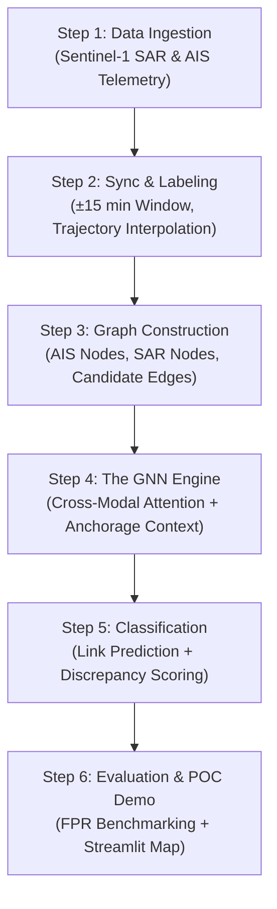

# End-to-End System Blueprint: How We Will Build It
**Project:** A Cross-Modal Spatiotemporal Graph Framework for Detecting Dark-Vessel Candidates  
**Audience:** Bajio (Data Lead), Brual (Algorithm Lead), Bustos (Evaluation/POC Lead)  
**Goal:** A complete, intuitive, step-by-step walkthrough of what we are building, why it works, and how each component connects.

---

## 1. The Core Mental Model: What Are We Actually Building?

Imagine an air traffic controller looking at two different screens:
1. **Screen A (AIS Transponder):** Ships reporting where they are via radio GPS.
2. **Screen B (SAR Satellite Radar):** A physical photograph taken from space showing actual metal objects floating on the water.

```
       ┌────────────────────────┐         ┌────────────────────────┐
       │     SCREEN A: AIS      │         │     SCREEN B: SAR      │
       │  (Self-Reported Radio) │         │   (Physical Reality)   │
       │   "I am ship #12345"   │         │   "There is a ship"    │
       └───────────┬────────────┘         └───────────┬────────────┘
                   │                                  │
                   └─────────────────┬────────────────┘
                                     ▼
                   ┌──────────────────────────────────┐
                   │    THE CORE RESEARCH QUESTION    │
                   │ For every metal blob on radar:   │
                   │ Is it an innocent match?         │
                   │ A normal port traffic delay?     │
                   │ OR an unexplained dark vessel?   │
                   └──────────────────────────────────┘
```

In an empty ocean, matching is easy: nearest dot wins.  
**In Batangas Bay, nearest-neighbor collapses** because 20 ships are anchored close together, AIS signals drop out due to radio interference, and ships wait legitimately for berths.  

**Our Solution:** We feed both datasets into a **Graph Neural Network (GNN)** that understands spatial distance, ship heading, travel speed, port anchorage boundaries, and surrounding traffic congestion all at once.

---

## 2. The 6-Step End-to-End Pipeline



---

### Step 1: Data Ingestion (Gathering the Raw Ingredients)
* **Sentinel-1 SAR Radar:**
  - Downloaded freely from Copernicus Data Space Ecosystem (CDSE).
  - Pre-processed using standard SAR tools (SNAP or open Python library `rasterio`/`scikit-image`) to extract ship detections: **[Latitude, Longitude, Length, Beam Width, Radar Brightness ($\sigma^\circ$)]**.
* **AIS Telemetry:**
  - Downloaded from Global Fishing Watch (GFW) or coastal open archives.
  - Filtered to Batangas Bay ($13.60^\circ\text{N}\text{--}13.85^\circ\text{N},\, 120.90^\circ\text{E}\text{--}121.15^\circ\text{E}$).
  - Raw attributes: **[MMSI, Timestamp, Latitude, Longitude, Speed (SOG), Course (COG), Vessel Type]**.

---

### Step 2: Temporal Synchronization & 3-Tier Ground Truth
* **The 30-Minute Matching Window ($\pm 15$ min):**
  - The satellite snaps its picture at one exact second ($T_{\text{SAR}}$).
  - We extract all AIS pings from $T_{\text{SAR}} - 15\text{ min}$ to $T_{\text{SAR}} + 15\text{ min}$.
  - Using **cubic spline trajectory interpolation**, we estimate where each AIS vessel was at the exact moment of the satellite overpass.
* **The Deterministic 3-Tier Labels (For Training & Testing):**
  1. **Matched Vessel (Class 0):** High-confidence reference pairs in open waters where only one vessel exists within $>3\text{ km}$, and SAR dimensions/heading match AIS within $\pm 20\%$.
  2. **Discrepancy Candidate (Class 1):** Verified real-world vessels with **synthetically dropped AIS** (10% to 90% artificial dropout). We know 100% that a ship is there, but its AIS is absent.
  3. **Ambiguous Target (Class 2):** Radar detections $<25\text{ m}$ (small bangkas exempt from SOLAS AIS carriage) or $<150\text{ m}$ from piers (dock reflections). These are **masked out** so they don't corrupt the training loss.

---

### Step 3: Graph Construction (Structuring the Data)
Before the AI runs, we convert the map into a **Heterogeneous Graph** $G = (V, E)$:

```
           AIS Node A1                         SAR Node S1
       [lat, lon, SOG, COG]               [lat, lon, L, W, σ°]
               ○                                   ●
                \                                 / 
                 \  Candidate Edge e_11          /  Candidate Edge e_21
                  \ (Δd, Δt, Δθ, speed_consist) /
                   \                           /
                    ▼                         ▼
              AIS Node A2 ───────────────── SAR Node S2
                                  ...
```

1. **Nodes ($V$):**
   - **AIS Nodes:** Feature vector containing normalized position, speed, course, vessel type, and ping gap interval.
   - **SAR Nodes:** Feature vector containing centroid coordinates, estimated length, width, and radar cross-section.
2. **Edges ($E$):**
   - **Cross-Modal Candidate Edges ($e_{ij}$):** Connect a SAR node to **every** AIS node within a reachability radius ($R_{\text{max}} = 3\text{--}5\text{ km}$). We do **not** assume who matches whom—multiple edges are drawn in crowded spots!
   - **Inter-Vessel Edges:** Connect nearby AIS ships to other AIS ships ($\le 2\text{ km}$) and nearby SAR nodes to SAR nodes. This lets the graph "see" traffic density and port queues.
   - **Edge Features:** Distance ($\Delta d$), heading difference ($\Delta \theta$), speed consistency, and local traffic count.

---

### Step 4: The GNN Engine (The Novel Computer Science Core)
This is your BSCS thesis contribution. The model processes the graph in 3 stages:

```
[AIS Features] ──> [AIS Linear Encoder]  ──┐
                                           ├──> [Cross-Modal Graph Attention] ──> [Anchorage Context Filter]
[SAR Features] ──> [SAR Linear Encoder]  ──┘
```

1. **Modality-Specific Projection Encoders:**
   - AIS features (telemetry) and SAR features (radar pixels) have different dimensions and units.
   - Separate linear projection layers map both into a **shared latent embedding space** of dimension $d$ (e.g., 64-dimensional vectors).
2. **Cross-Modal Graph Attention (GATv2 / Edge-conditioned Attention):**
   - The GNN computes attention weights $\alpha_{ij}$ along each candidate edge.
   - It compares node features and edge features (distance, heading agreement, speed).
   - Attention message passing lets nodes aggregate information from their neighbors: if an AIS node is surrounded by 5 other ships in a lane, its embedding reflects that congested context.
3. **Anchorage-Aware Contextual Gate:**
   - Batangas Port anchorage polygons (official PPA geofences) are embedded as a geographic feature.
   - If a vessel is within an anchorage polygon and has low speed ($<1\text{ knot}$) with high dwell time, the gate attenuates false-positive anomaly scores. It recognizes this as normal waiting behavior.

---

### Step 5: Classification & Decision (Link Prediction vs. Discrepancy)
The network performs two decoupled tasks:

* **Task A: Link Prediction (Association):**
  - For every candidate edge between an AIS node $i$ and SAR node $j$, the model outputs an association probability:
    $$P(\text{Match}_{ij}) = \sigma(\mathbf{W} \cdot [\mathbf{h}_i \,\|\, \mathbf{h}_j \,\|\, \mathbf{e}_{ij}])$$
  - If $P(\text{Match}_{ij}) > 0.5$ (and passes softmax competition against nearby rivals), the pair is declared **Matched**.
* **Task B: Discrepancy Scoring (Dark-Vessel Candidate Detection):**
  - If a SAR detection node $j$ has **no valid link** to any AIS node across all its candidate edges:
    $$\text{Discrepancy Score}(j) = 1 - \max_{i} P(\text{Match}_{ij})$$
  - If this score exceeds a calibrated threshold (and is not an ambiguous dock reflection), SAR node $j$ is flagged as a **Dark-Vessel Candidate**.

---

### Step 6: Evaluation & The Pre-Oral Proof-of-Concept (POC)

#### How We Test It (Objective 3):
1. **Baselines:** Compare against Hungarian Algorithm (standard rule-based association) and Unimodal models.
2. **Key Metric:** **False-Positive Rate (FPR)** is prioritized alongside Precision, Recall, and F1. (Goal: achieve $<5\%$ FPR in anchorage zones).
3. **Stress-Testing:** Test performance under 10%, 30%, 50%, 70%, and 90% synthetic AIS dropouts.

#### The Interactive POC Dashboard (Objective 4):
Built using **Python + Streamlit + Folium/Leaflet**:
* **Map Display:** Loads a historical Sentinel-1 overpass over Batangas Bay.
* **Visual Elements:**
  - 🟢 **Green Boxes:** Successfully matched SAR detections (click to view the linked AIS vessel name, MMSI, and speed).
  - 🔴 **Red Boxes:** Flagged **Dark-Vessel Candidates** (SAR target present, 0 valid AIS broadcasts).
  - 🟡 **Yellow Dashed Circles:** Official Batangas Port Anchorage Zones (showing why stationary targets here are suppressed from raising false alarms).
  - 📊 **Sidebar Metrics:** Live association confidence score, inference latency (ms), and traffic density count.

---

## 3. Visual GNN Architecture & Algorithmic Breakdown

### Visual A: End-to-End GNN Deep Learning Pipeline
```
[INPUT LAYER]
  ├── AIS Nodes: x_i^AIS = [lat, lon, SOG, COG, ping_gap]
  ├── SAR Nodes: x_j^SAR = [lat, lon, length, width, backscatter σ°]
  └── Candidate Edges: e_ij = [Δdist, Δtime, Δheading, speed_consist, density]
         │
         ▼
[MODALITY-SPECIFIC MLP ENCODERS]
  ├── h_i^AIS = MLP_AIS(x_i^AIS)  ──┐
  │                                 ├──> [Shared Latent Space: ℝ^d (d-dim)]
  └── h_j^SAR = MLP_SAR(x_j^SAR)  ──┘
         │
         ▼
[CROSS-MODAL GRAPH ATTENTION (GATv2)]
  ├── Edge-Conditioned Attention: α_ij = Softmax(LeakyReLU(a^T [W_s h_j || W_a h_i || W_e e_ij]))
  └── Spatiotemporal Message Passing: Aggregates context across neighboring vessels & time
         │
         ▼
[ANCHORAGE-AWARE CONTEXTUAL FILTER]
  └── Ingests official port anchorage geofence polygon + dwell-time threshold (v < 1 knot)
      Attenuates false discrepancy scores for legitimate berth-waiting vessels
         │
         ▼
[DUAL TASK OUTPUT HEADS]
  ├── Head 1 (Link Prediction): P(Match_ij) = σ(W_assoc [h_i || h_j || e_ij])  ──> AIS-SAR Association
  └── Head 2 (Discrepancy Scorer): S_dark(j) = (1 - max_i P(Match_ij)) * (1 - Gate_anchorage)
```

---

### Visual B: Candidate Edge Construction & Attention Mechanism (At the Node Level)

* **Step A: Candidate Edge Construction (Before GNN runs)**  
  For any SAR detection $s_j$, draw a search circle with reachability radius $R_{\text{max}}$ (3 to 5 km). Connect $s_j$ with candidate edges to **all** AIS nodes ($a_1, a_2, a_3$) inside that circle. Each edge carries physical features: $[\Delta d, \Delta \theta, \Delta v]$.
* **Step B: Cross-Modal Attention Computation (Inside GNN)**  
  The edge vectors pass through MLPs and a Softmax function. If $a_1$ shares the same heading and speed vector, it receives a dominant attention weight (e.g., $\alpha = 0.88$), while $a_2$ and $a_3$ receive low weights ($0.09, 0.03$). The GNN declares $a_1$ as the **True Match**.
* **Step C: Unmatched Discrepancy Detection (Dark-Vessel Candidate)**  
  If a SAR detection $s_j$ has no candidate AIS nodes within $R_{\text{max}}$, or if all candidate edges yield near-zero attention ($\alpha_{ij} \approx 0$), the network flags $s_j$ as an **Unexplained AIS-SAR Discrepancy $\rightarrow$ Dark-Vessel Candidate**.

---

## 4. Team Responsibilities Summary


| Member | Primary Focus | Tools & Outputs |
|:---|:---|:---|
| **Sandara (Data Lead)** | Data ingestion, interpolation, labeling rules, train/test splitting | Python (`pandas`, `geopandas`, `scipy`), Copernicus CDSE, GFW AIS |
| **Keirk (Algorithm Lead)** | GNN architecture, cross-modal attention, anchorage gate, loss function | PyTorch, PyTorch Geometric (`torch_geometric`), Google Colab |
| **Janison (Evaluation & POC Lead)** | Hungarian baseline, FPR/Recall logging, Streamlit interactive dashboard | Python, `scikit-learn`, `streamlit`, `folium` |

